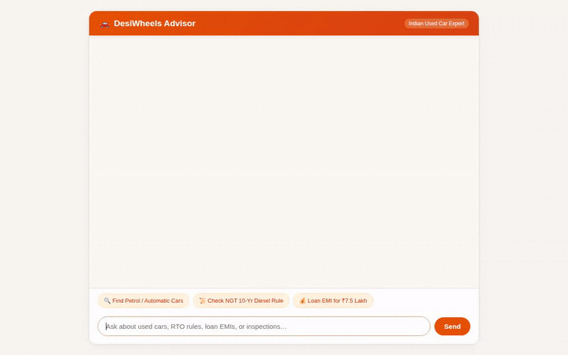

# DesiWheels - Indian Used Car Advisory & Matchmaking Agent

An intelligent, domain-specialized advisory agent built with Google's Agent Development Kit (ADK) and Gemini on Google Cloud Agent Platform. DesiWheels guides Indian used car buyers through verified inventory search, RTO and NGT regulatory compliance (such as Delhi-NCR's 10-year diesel ban), secure loan EMI calculations in a code sandbox, dealership geocoding, and multi-modal AI car image & video generation.



---

## What DesiWheels Does

DesiWheels is specifically engineered for the nuances of the Indian used automobile ecosystem:

1. **Verified Used Car Search (`search_used_cars`, `get_car_details`, `add_car_listing`)**
   - Queries a Google Cloud Firestore collection (`cars`) filtered by budget in ₹ Lakhs, city (Delhi NCR, Bengaluru, Mumbai, Hyderabad, Pune, etc.), make, model, year, transmission, and fuel type.
   - Surfaces verified listings with owner history, odometer mileage, service records, and insurance validity.

2. **RTO & NGT Compliance Engine (`check_rto_compliance`)**
   - Automatically evaluates strict regional vehicle regulations across Indian states:
     - **Delhi-NCR**: Enforces the National Green Tribunal (NGT) 10-year age limit on diesel and 15-year limit on petrol vehicles.
     - **Emission Norms**: Distinguishes BS4 vs. BS6 compliance for interstate entry and low-emission zones.
     - **Interstate Transfers**: Checks road tax differential liabilities and No Objection Certificate (NOC) requirements when transferring vehicles between state RTOs.

3. **Code Sandbox Financial Calculator (`calculate_car_loan_emi`)**
   - Executes Python calculations within an isolated Vertex AI Code Execution Sandbox (`AgentEngineSandboxCodeExecutor`).
   - Computes exact monthly EMI payments, total interest payable, and total loan payback amounts based on vehicle price in ₹ Lakhs, down payment, interest rate, and tenure in months.

4. **Public Registry VIN Decoder (`decode_vin_specs`)**
   - Connects to the public NHTSA / vPIC VIN decoding API to verify factory vehicle specs, body class, displacement, and plant details against user-provided VINs.

5. **Geocoding & Dealership Locator (`geocode_address`, `find_nearby_places`)**
   - Integrates with Google Maps Geocoding API and Google Places API (New) to locate nearby authorized dealerships, multi-brand pre-owned outlets, and vehicle inspection centers for test drives.

6. **AI Vehicle Image Generation (`generate_car_image`)**
   - Generates realistic vehicle renders using `gemini-3.1-flash-lite-image` in the Vertex AI `global` region.
   - Saves artifacts to the agent's Artifacts store via `tool_context.save_artifact` and uploads the resulting image bytes directly to a public Google Cloud Storage bucket (`desiwheels-gallery-2379`), returning a public HTTPS URL.

7. **AI Automotive Video Generation (`generate_car_video`)**
   - Generates 3-to-10 second video scenes using Google's Omni model (`gemini-omni-flash-preview`) in the Vertex AI `global` region via the Interactions API.
   - Saves video artifacts with `tool_context.save_artifact` and uploads the MP4 bytes directly to Google Cloud Storage (`desiwheels-gallery-2379`), returning a public HTTPS URL.

8. **A2UI Interactive Interface (`a2ui_callback`)**
   - Emits structured A2UI (Agent-to-User Interface) cards, column layouts, image components, and material icons via an `after_model_callback` so visual components render natively in the frontend.

9. **Cross-Session Long-Term Memory (`PreloadMemoryTool` & Memory Bank)**
   - Integrates with Vertex AI Memory Bank (`ALLERGIES` custom topic spec) and an `after_agent_callback` (`generate_memories_callback`).
   - Recalls buyer preferences, shortlisted models, target budgets, and sensitivities across independent sessions.

---

## Google Cloud & Platform Services Used

The codebase directly wires and integrates the following managed Google Cloud services:

- **Gemini Foundation Models**:
  - `gemini-3.8-flash`: Primary reasoning, conversational orchestration, and tool selection.
  - `gemini-3.1-flash-lite-image`: Multimodal car image generation (global region).
  - `gemini-omni-flash-preview`: Generative video clips (Interactions API, global region).
- **Google Cloud Agent Platform (Agent Runtime)**:
  - Managed agent engine runtime deployment with A2A protocol support.
  - Vertex AI Code Execution Sandbox for financial computations.
  - Vertex AI Memory Bank for persistent conversational memory.
- **Google Cloud Firestore**:
  - Serverless NoSQL document database hosting the used car catalog in native Datastore mode.
- **Google Cloud Storage (GCS)**:
  - Public object storage bucket (`desiwheels-gallery-2379`) storing generated car images and video clips.
- **Google Maps Platform**:
  - Geocoding API and Places API (New) for location searches and dealership discovery.

---

## Planned / Future Features

The following features from the initial concept brief are planned for future iterations:
- **`fair_price_estimator`** *(Planned, not yet implemented)*: Automated statistical depreciation curves against market sales averages.
- **`scam_and_inspection_checklist`** *(Planned, not yet implemented)*: Dynamic interactive inspection forms with OBD-II scanner integration.
- **RAG Engine Corpus** *(Planned, not yet implemented)*: Grounding on state-by-state motor vehicle taxation statutes and gazette notifications.

---

## Project Structure

```
desi-wheels/
├── app/
│   ├── agent.py               # Root agent definition, system prompts, callbacks, tools
│   ├── car_tools.py           # Firestore catalog, RTO engine, Maps, Image/Video gen
│   ├── a2ui_utils.py          # A2UI schema manager and after_model_callback
│   ├── fast_api_app.py        # Local ADK backend server
│   └── app_utils/             # Runtime utilities
├── frontend/
│   ├── main.py                # FastAPI proxy connecting browser to deployed agent over A2A
│   ├── requirements.txt       # Frontend dependencies (a2a-sdk, fastapi, uvicorn)
│   ├── Dockerfile             # Container definition for frontend Cloud Run deployment
│   └── static/
│       └── index.html         # DesiWheels branded dialogue UI with A2UI renderer
├── seed_cars.py               # Firestore catalog seeding script
├── agents-cli-manifest.yaml   # Agent Engine deployment configuration
├── pyproject.toml             # Python dependencies (adk, google-genai, google-cloud-firestore)
└── demo.gif                   # Recorded live walkthrough demo
```

---

## Local Setup & Run Instructions

### 1. Prerequisites

- Python 3.11+
- [uv](https://docs.astral.sh/uv/) package manager
- Google Cloud SDK (`gcloud`) authenticated to your GCP project:
  ```bash
  gcloud auth login
  gcloud auth application-default login
  gcloud config set project <your-project-id>
  ```

### 2. Environment Configuration

Copy the example environment file and fill in required keys:

```bash
cp .env.example .env
```

Ensure the following variables are present in `.env`:
```env
GOOGLE_GENAI_USE_VERTEXAI=true
GOOGLE_CLOUD_PROJECT=<your-project-id>
GOOGLE_CLOUD_LOCATION=global
GOOGLE_MAPS_API_KEY=<your-google-maps-api-key>
```

### 3. Install Dependencies & Seed Catalog

```bash
uv sync
uv run python seed_cars.py
```

### 4. Run the Agent Locally (ADK Web)

Launch the ADK development playground to test tools, artifacts, and A2UI:

```bash
uv run adk web app
```

### 5. Run the Custom Frontend Locally

To run the branded DesiWheels dialogue chat frontend:

```bash
cd frontend
python -m venv .venv
source .venv/bin/activate
pip install -r requirements.txt

# Export the deployed agent engine resource ID (or let main.py read deployment_metadata.json)
export AGENT_DIRECTORY="app"
python main.py
```

The frontend server starts on port `8080`.

---

## Deployment Instructions

### Deploy Agent to Agent Runtime

Deploy using `agents-cli`:

```bash
agents-cli deploy \
  --project <your-project-id> \
  --region us-east1 \
  --update-env-vars GOOGLE_MAPS_API_KEY=<your-maps-key>
```

### Deploy Frontend to Cloud Run

Deploy the containerized proxy and chat UI from the `frontend/` folder:

```bash
cd frontend
gcloud run deploy desi-wheels-frontend \
  --source . \
  --region us-east1 \
  --allow-unauthenticated \
  --set-env-vars AGENT_ENGINE_RESOURCE_NAME="<resource-name-from-deployment_metadata.json>",AGENT_DIRECTORY="app"
```
